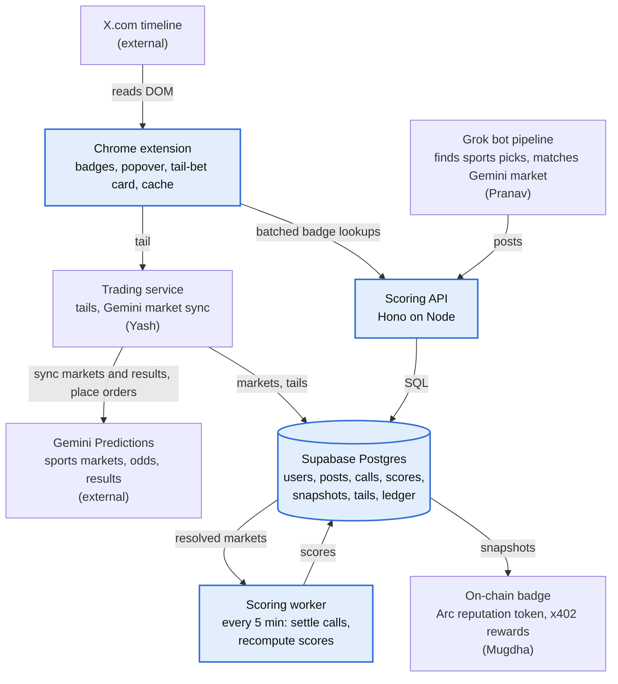
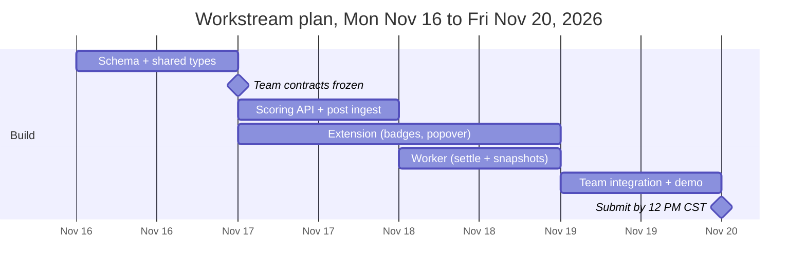

# coPAYMe — Scoring & Extension Design Doc

Aditya Mallepalli · Nov 16, 2026 · Updated Nov 18, 2026

## Overview

This workstream ships three things: the track-record score, the shared Supabase schema and cache, and the Chrome extension that shows a badge next to X handles. All three are due by Nov 20, 2026 at 12:00 PM CST.

coPAYMe is "autopilot for prediction markets." The extension shows how good a person's past calls on X have been, then lets you tail their next pick on Gemini Predictions with one click. It can be a paper trade or a live trade. We submit to the **Consumer Applications** track, the **Best use of Arc** chain award, and the **Gemini Prediction Markets** and **Grok Bot** bounties.

Launch scope is **sports markets only**. A sports tweet maps to exactly one market with a fixed lock time (game start) and a clean result, so every call can be scored without guessing. Open-ended calls like "buy bitcoin" have no clear timeframe and are easier to manipulate, so they wait until after the demo.

## Goals and non-goals

The demo goal: scroll an X sports timeline, see a badge on every scored handle, open it to see the calls behind the score, and tail a pending pick.

**Goals**

- **Fast badges.** A badge appears within 300 ms of a tweet rendering, usually from the extension cache, with at most one batched API call per scroll burst.
- **Explainable score.** Clicking a badge lists every scored call: the odds when it was tweeted, the result, and the points earned.
- **Verifiable score.** Each recompute writes a snapshot with a hash of its inputs, which the on-chain reputation badge on Arc can reference.
- **One shared schema.** Every teammate writes to the same Supabase tables, and one `packages/shared` module holds the TypeScript types for all of them.

**Non-goals**

- Non-sports markets (crypto, politics, culture) until after the demo.
- Browsers other than Chrome, and mobile.

**Built by teammates in this hackathon (outside this doc's scope)**

- Pranav: the Grok bot pipeline that reads X posts, tags their sentiment, and matches them to Gemini markets.
- Yash: one-click and paper trading on Gemini.
- Mugdha: X login, wallet connection, the Arc reputation token, and x402 rewards.

## Architecture



Highlighted boxes are owned by this workstream. The trading service keeps `markets` in sync with Gemini; teammates write posts and read score snapshots through the API and Supabase. The extension only reads precomputed scores, so a badge costs one cached lookup.

## Detailed design

### Data model (Supabase Postgres)

Eight tables, all owned by this workstream's migrations. Teammates write only to the columns listed for them.

| Table | Key columns | Written by | Read by |
| --- | --- | --- | --- |
| `users` | `id`, `x_user_id` (unique), `x_handle`, `wallet_address`, `rewards_opt_in`, `created_at` | Ingest (on first post), Mugdha (X login, wallet link, opt-in) | Everyone |
| `posts` | `id`, `tweet_id` (unique), `user_id`, `tweeted_at`, `tweet_text`, `sentiment` (stored as sent; shape set in Pranav's design), `gemini_market_id` (nullable), `picked_outcome` (nullable), `parsed_at` | Pranav's Grok pipeline via `POST /v1/posts` | Ingest, worker, later market types |
| `markets` | `id`, `gemini_market_id` (unique), `sport`, `event_name`, `outcomes` (`[{label, instrumentSymbol, currentOdds}]`), `lock_time`, `status` (open, locked, resolved, void), `winning_outcome`, `resolved_at`, `synced_at` | Trading service market sync (Yash) | Ingest, worker, extension |
| `calls` | `id`, `post_id` (unique), `user_id`, `market_id`, `picked_outcome`, `tweeted_at`, `odds_at_call` (0 to 1), `odds_source` (history, snapshot), `ingest_lag_s`, `status` (pending, scored, void, rejected), `points` | Ingest (promoted from `posts`), worker | API, extension |
| `user_scores` | `user_id` (PK), `score` (0 to 100), `score_change_14d`, `skill`, `n_resolved`, `n_wins`, `hit_rate`, `last_call_at`, `snapshot_id`, `updated_at` | Worker only | API |
| `score_snapshots` | `id`, `user_id`, `score`, `call_ids`, `inputs_hash` (sha256), `computed_at`, `onchain_tx` | Worker; Mugdha fills `onchain_tx` | Mugdha, extension |
| `tails` | `id`, `follower_id`, `call_id`, `mode` (paper, live), `amount_usdc`, `entry_odds`, `gemini_order_id`, `status` (open, filled, settled, cancelled), `pnl_usdc`, `created_at` | Yash's trading service | Extension, Mugdha |
| `earnings_ledger` | `id`, `user_id`, `amount_usdc`, `reason`, `tx_hash`, `created_at` | Mugdha (x402 rewards) | Extension |

Every post Pranav's pipeline sends lands in `posts` with its sentiment, whether or not it matched a market. Ingest promotes a post to a `calls` row only when it matched an open sports market with a clear pick and was tweeted before the market locked. Unmatched posts stay in `posts`, so they can be matched later if we add market types.

Two constraints do the anti-gaming work in the database itself: `unique (user_id, market_id)` on `calls`, so the first pick per market is the only one that counts, and an insert check that rejects any call with `tweeted_at >= markets.lock_time`. The first is in the merged migration; the lock-time check is not yet and will be added with the ingest endpoint.

### Scoring: beat the market, shrunk for small samples

A call earns points equal to what one $1 contract would have made if bought at the market price when the user tweeted. Picking the favourite earns little, and correctly calling an underdog earns a lot. So someone with no edge over the Gemini odds averages zero, however often their picks win.

```math
\text{points}_i = y_i - p_i \qquad y_i \in \{0, 1\},\; p_i = \text{market-implied probability of the pick at } t_{\text{tweet}}
```

```math
\text{skill} = \frac{\sum_{i=1}^{n} \text{points}_i}{n + k}, \qquad k = 10
```

```math
\text{score} = \mathrm{round}\left(50 + 50 \tanh\left(\frac{\text{skill}}{0.15}\right)\right)
```

- A winning pick on a 0.85 favourite earns +0.15, and a winning pick on a 0.35 underdog earns +0.65. A losing pick on a 0.85 favourite costs −0.85.
- `k = 10` acts like ten phantom zero-point calls, so three lucky underdog wins cannot produce a top score.
- `tanh` maps skill onto 0 to 100 with 50 as "no edge." A sustained edge of about +0.15 per call reaches roughly 88.
- The badge shows the score, the number of resolved calls and the hit rate. Users with fewer than 5 resolved calls show a grey **New** badge instead of a number.
- Void or cancelled markets void their calls.
- Deleted tweets still count, because the call row stores the tweet text. That stops users from deleting their losing picks.

### Score change arrow

The badge shows the score with its change over the last 14 days, for example **72 ▲8** or **41 ▼6**. Followers can then tell a caller who is good right now from one whose good run is in the past.

- `score_change_14d` = the current score minus the score in the latest snapshot that is at least 14 days old.
- No arrow when no snapshot is that old yet, or when the change is under 2 points.
- The worker computes it on every recompute, so a badge lookup costs nothing extra.
- The popover shows the same change with the date it is measured from.

### Odds at call time

`odds_at_call` must be the price at `tweeted_at`, not the price when we ingested the call. If Gemini exposes price history for a market, the ingest endpoint looks up that price and sets `odds_source = history`. If it does not, ingest stores the live price with `odds_source = snapshot` and records `ingest_lag_s`. Snapshot calls with more than 600 s of lag are stored but not scored, because the line may already have moved. The trading service's Gemini client has no price-history call today, so plan on `snapshot`. The live price comes from `markets.outcomes[].currentOdds`, which is only as fresh as the last market sync, so the sync must run on a schedule (see open questions) or ingest must read the price from Gemini directly.

### Scoring API

A Hono app on Node, versioned under `/v1`. Read routes are public and cached. Write routes need a service key that only teammates' services hold.

| Route | Returns | Caller |
| --- | --- | --- |
| `GET /v1/badges?handles=a,b,c` (up to 50) | `{ [handle]: { score, change14d, tier, nResolved, hitRate } }`, with `null` for unknown handles | Extension background worker |
| `GET /v1/users/:handle` | Profile, score breakdown, latest snapshot hash | Extension popover |
| `GET /v1/users/:handle/calls?cursor=` | Paged call ledger, newest first | Extension popover |
| `GET /v1/calls/by-tweet/:tweetId` | The call parsed from that tweet and its market, if one exists | Extension tail card |
| `POST /v1/posts` (service key, single or batch) | `201` with the post id and the call outcome per post: `created`, or `skipped` with a reason (no market, after lock, duplicate pick) | Pranav's Grok pipeline |
| `GET /v1/users/:handle/snapshot` | Latest `score_snapshots` row | Mugdha's on-chain minter |

### Scoring worker

A `node-cron` job inside the API process runs every 5 minutes:

1. Find markets that the trading service's sync has marked `resolved` or `void` since the last run. The sync reads each settled Gemini event and fills `winning_outcome`, so the worker does not call Gemini itself.
2. For each newly resolved market, set `points` on its pending calls and mark them `scored` (or `void`).
3. Recompute `user_scores` for the affected users with one SQL aggregate, including the 14-day score change.
4. Write a `score_snapshots` row with `inputs_hash = sha256(sorted call_id:points pairs)`.
5. Evict those handles from the API cache, so the next badge lookup gets the new score.

### Caching

Scores change only when a game settles, so badges can be cached aggressively. The only consistency requirement is that a settled game shows up within about 10 minutes.

| Layer | Holds | TTL | Invalidation |
| --- | --- | --- | --- |
| Content-script memory | Badges for handles already seen in this tab | Tab lifetime | None |
| `chrome.storage.local` | Badge per handle; negative entries for handles we have no data on | 10 min (30 min for negative entries) | Cache-version bump on extension update |
| API in-process LRU (5,000 entries) | `/badges` entry per handle | 60 s | Worker evicts on recompute |
| `user_scores` table | Precomputed score per user | Until the next settle | Worker |

Batching: the content script collects new handles from a `MutationObserver`, debounces for 150 ms, and sends one message to the background worker. The worker fills what it can from cache and sends the rest as a single `/badges` request.

### Chrome extension (WXT + React, MV3)

- **Content script on `x.com`.** Finds each tweet's author handle in the tweet header, then mounts a badge (score and change arrow) in a shadow root next to the name so X's CSS cannot touch it. All X DOM selectors live in one `selectors.ts` file.
- **Background service worker.** Owns caching, batching and every API call, which keeps CORS and the API URL out of the page.
- **Badge popover.** Opens on click and shows the score, hit rate, resolved-call count, the last 5 calls (odds at call time, result, points) and a link to the full ledger.
- **Tail card.** Appears when the tweet itself is a pending call. It shows the pick, the odds then and now, a paper/live toggle and an amount, then sends the tail to Yash's trade endpoint.
- **Toolbar popup.** Sign in with X (Mugdha's flow), wallet status, and a setting to hide badges under N resolved calls.

## Tech stack

The whole workstream is TypeScript, so the extension, the API and teammates' services share one set of types.

| Layer | Choice | Why |
| --- | --- | --- |
| Language | TypeScript on Node 20+ | Same language as the extension; the x402 and Circle SDKs are TypeScript-first |
| API | Hono | Small and typed; route schemas come from Zod |
| Database | Supabase Postgres through the `postgres` driver and a `DATABASE_URL`, migrations in `supabase/migrations` | One hosted database the whole team can reach, with a free tier and built-in X OAuth. A plain connection string also works against a local Postgres for development |
| Shared types | Zod schemas in `packages/shared` | One definition validates API input and types the extension |
| Scheduling | `node-cron` in the API process | No extra infrastructure for a 5-minute job |
| Extension | WXT + React, Manifest V3 | Hot reload and shadow-DOM content-script UI out of the box |
| Repo | pnpm workspaces: `apps/api`, `apps/extension`, `apps/trading` (Yash), `packages/shared` | Teammates add `apps/<service>` next to these |
| API hosting | Railway (proposed) | Always-on Node process so the cron job keeps running |

## Integration contracts

Each teammate touches this workstream through one table or one endpoint. These shapes should be frozen by end of day Nov 17 so everyone can build against them.

| Teammate | They provide | This workstream provides |
| --- | --- | --- |
| Pranav (Grok bot pipeline) | Every parsed X post via `POST /v1/posts`: its sentiment, and the matched Gemini market and pick when there is one | Storage for all posts, call promotion, odds lookup, dedupe and lock checks, and a per-post reason when a post is not scored |
| Yash (one-click trading) | `POST /v1/tails` on the trading service (port 8788), which writes `tails` rows; the Gemini market sync that fills `markets` | Tail card UI, call and market ids, odds at call time and now |
| Mugdha (on-chain, x402, X login) | X login session and wallet link into `users`; `onchain_tx` on snapshots; `earnings_ledger` rows | `score_snapshots` with `inputs_hash` for the Arc reputation token; earnings shown in the popover |
| Gemini market sync (Yash's trading service) | Rows in `markets` for open sports markets, plus results, via `POST /v1/markets/sync` (service key) | The worker that reads resolved markets, and ingest, which reads current odds |

The post-ingest payload, from `packages/shared`:

```ts
export const NewPost = z.object({
  tweetId: z.string(),
  xUserId: z.string(),
  xHandle: z.string(),
  tweetedAt: z.string().datetime(),
  tweetText: z.string(),
  sentiment: z.unknown(), // shape set in Pranav's design doc
  geminiMarketId: z.string().nullable(),
  pickedOutcome: z.string().nullable(),
});
```

The tail request the extension sends to `POST /v1/tails` on the trading service, with an `X-Follower-Id: <user uuid>` header until Mugdha's X login replaces it:

```ts
export const TailRequest = z.object({
  callId: z.string().uuid(),
  mode: z.enum(["paper", "live"]),
  amountUsdc: z.number().positive(),
  quotedOdds: z.number().min(0).max(1),
});
```

The trading service rejects the tail if the live price has moved more than 5 cents from `quotedOdds`. It answers with `{ tailId, status, mode, entryOdds, amountUsdc, geminiOrderId, pnlUsdc }`. The types live in `packages/shared/src/trading.ts`.

## Milestones



The extension runs longest because it needs the live API before its popover and tail card can be finished. Done means:

- [ ] **Mon Nov 16:** design doc shared; Supabase project created; migration for all eight tables; Zod types in `packages/shared`.
- [ ] **Tue Nov 17:** `POST /v1/posts` and `GET /v1/badges` live with seed data; extension shows badges on x.com from the API; contracts agreed with the team.
- [ ] **Wed Nov 18:** worker settles calls against Gemini results and writes snapshots; extension cache and batching done; popover shows the call ledger.
- [ ] **Thu Nov 19:** Pranav's posts flowing in; tail card hitting Yash's endpoint; Mugdha reading snapshots; full demo run on a real sports timeline.
- [ ] **Fri Nov 20 AM:** README architecture section, scoring explanation, demo video, and Devpost submission before 12:00 PM CST.

## Risks and open questions

The biggest risk to the demo is having too few resolved sports calls to show real scores. The biggest product risk is high-score users steering their followers.

| Risk | Effect | Mitigation |
| --- | --- | --- |
| Few resolved calls before Nov 20 | Every badge reads New | Backfill past tweets against already-resolved Gemini markets; if that is not possible, use seeded demo data labelled as such |
| Copy-trader manipulation: a high-score user tweets a pick, followers move a thin market, and the user sells into it | Followers buy at a worse price | Score at the price when the user tweeted; tail card shows how far the odds moved since the call; cap tail amount per call |
| Hedging or deleting losers | Inflated scores | First pick per market is the only one that counts; deleted tweets still scored |
| No Gemini price history | Odds at call time are approximate | `odds_source` and `ingest_lag_s` recorded; calls with more than 600 s of lag are not scored |
| Market odds go stale between syncs | Scores, the slippage check and live order prices use old odds | Run the sync every 5 minutes, or have ingest read the live price from Gemini |
| Follower id is a plain header and live orders use one shared Gemini key | Anyone can place tails as anyone, all live trades hit the team's account | Sandbox only for the demo; replace the header with Mugdha's X login before anything real |
| Market has no expiry date, so `lock_time` falls back to a placeholder a year out | The lock check never fires for that market | Skip markets with no expiry in ingest |
| X changes its page markup | Badges vanish mid-demo | All selectors in one file; fallback match on the profile link in the tweet header; re-test the morning of Nov 20 |
| Grok parser maps a tweet to the wrong market | A wrong call is scored | Popover links every call to its tweet so mistakes are visible |

**Open questions**

- [ ] Does the Gemini Prediction Markets API expose historical prices for a market? The trading service's client has no such call, so this stays open and `snapshot` is the default.
- [ ] Does the Gemini sandbox list enough sports markets to demo, and will enough of them settle before Nov 20? Someone needs to run `POST /v1/markets/sync` against the sandbox and look.
- [ ] Who runs the market sync on a schedule, and how often? Today it only runs when someone calls it.
- [ ] Tail card: Yash's PR assumes this workstream builds the card UI and the trading service owns the endpoint. Confirm.
- [x] Who owns the Gemini market sync? Yash's trading service, as of PR #20.
- [ ] The team doc says the reputation token is on Solana or Arc. Our chain award is Arc, so confirm Arc only with Mugdha.
- [ ] Who owns the Supabase project and the Railway deploy, and how are service keys shared?
