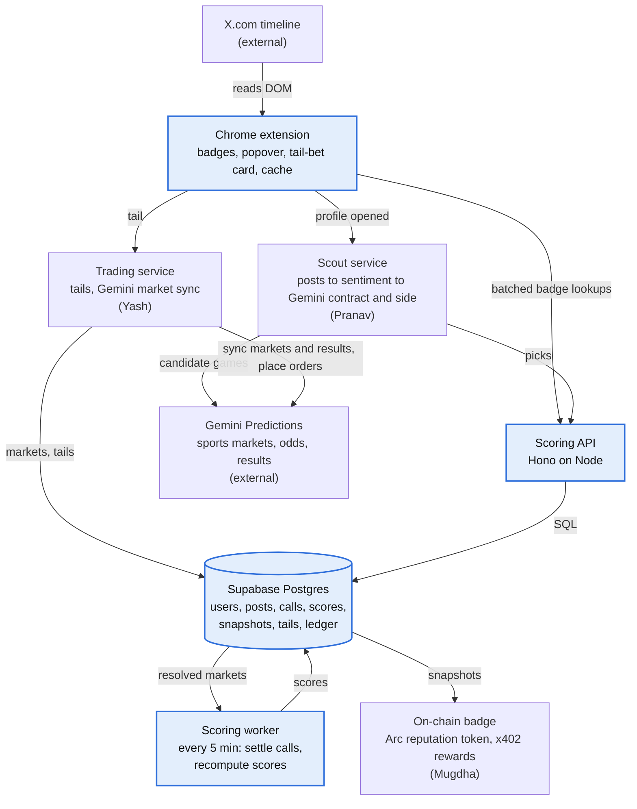
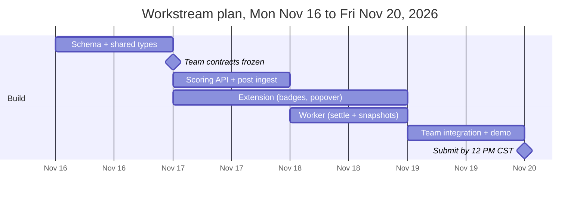

# coPAYMe — Scoring & Extension Design Doc

Aditya Mallepalli · Nov 16, 2026 · Updated Nov 18, 2026

## Overview

This workstream ships three things: the track-record score, the shared Supabase schema and cache, and the Chrome extension that shows a badge next to X handles. All three are due by Nov 20, 2026 at 12:00 PM CST.

coPAYMe is "autopilot for prediction markets." The extension shows how good a person's past calls on X have been, then lets you tail their next pick on Gemini Predictions with one click. It can be a paper trade or a live trade. We submit to the **Consumer Applications** track, the **Best use of Arc** chain award, and the **Gemini Prediction Markets** and **Grok Bot** bounties.

Launch scope is **sports markets only**. Each pick in a sports tweet maps to exactly one market with a fixed lock time (game start) and a clean result, so every call can be scored without guessing. Open-ended calls like "buy bitcoin" have no clear timeframe and are easier to manipulate, so they wait until after the demo.

## Goals and non-goals

The demo goal: scroll an X sports timeline, see a badge on every scored handle, open it to see the calls behind the score, and tail a pending pick.

**Goals**

- **Fast badges.** A badge appears within 300 ms of a tweet rendering, usually from the extension cache, with at most one batched API call per scroll burst.
- **Explainable score.** Clicking a badge lists every scored call: the odds when it was tweeted, the result, and the points earned.
- **Verifiable score.** Each recompute writes a snapshot with a hash of its inputs, which the on-chain reputation badge on Arc can reference.
- **One shared schema.** Every teammate writes to the same Supabase tables, and one `packages/shared` module holds the TypeScript types for all of them.

**Non-goals**

- Non-sports markets (crypto, politics, culture) until after the demo.
- Browsers other than Chrome, and mobile.

**Built by teammates in this hackathon (outside this doc's scope)**

- Pranav: the scout service (`apps/scout`, designed in `docs/design/grok-pipeline.md`), which fetches a handle's recent X posts, reads them with Grok, matches each pick to a Gemini contract and side, and forwards the picks to `POST /v1/posts`.
- Yash: one-click and paper trading on Gemini.
- Mugdha: X login, wallet connection, the Arc reputation token, and x402 rewards.

## Architecture



Highlighted boxes are owned by this workstream. The trading service keeps `markets` in sync with Gemini, the scout service sends picks through the API, and teammates read score snapshots from Supabase. Badge lookups only read precomputed scores, so a badge costs one cached lookup.

## Detailed design

### Data model (Supabase Postgres)

Eight tables live in `supabase/migrations/`. This workstream's migration holds `users`, `user_scores` and `score_snapshots`; Yash's holds `markets`, `posts`, `calls` and `tails`; `earnings_ledger` is Mugdha's and not written yet. Pranav's scout service adds its own `scout_handles` and `scout_posts`. Teammates write only to the columns listed for them.

| Table | Key columns | Written by | Read by |
| --- | --- | --- | --- |
| `users` | `id`, `x_user_id` (unique), `x_handle`, `wallet_address`, `rewards_opt_in`, `created_at` | Ingest (on first post), Mugdha (X login, wallet link, opt-in) | Everyone |
| `posts` | `id`, `tweet_id` (unique), `user_id`, `tweeted_at`, `tweet_text`, `sentiment` (the `Sentiment` type from `packages/shared`, defined in Pranav's design), `gemini_market_id` (nullable), `picked_outcome` (nullable), `parsed_at` | Pranav's scout service via `POST /v1/posts` | Ingest, worker, later market types |
| `markets` | `id`, `gemini_market_id` (unique), `sport`, `event_name`, `outcomes` (`[{label, instrumentSymbol, currentOdds, resolutionSide}]`), `lock_time`, `status` (open, locked, resolved, void), `winning_outcome`, `resolved_at`, `synced_at` | Trading service market sync (Yash) | Ingest, worker, extension |
| `calls` | `id`, `post_id` (not unique: a post can hold several picks), `user_id`, `market_id`, `picked_outcome`, `instrument_symbol`, `side` (yes, no), `tweeted_at`, `odds_at_call` (0 to 1, the price of the picked side, null when unpriced), `odds_source` (history, snapshot, none), `ingest_lag_s`, `status` (pending, scored, void, rejected), `points` | Ingest (promoted from `posts`), worker | API, extension |
| `user_scores` | `user_id` (PK), `score` (0 to 100), `score_change_14d`, `skill`, `n_resolved`, `n_wins`, `hit_rate`, `last_call_at`, `snapshot_id`, `updated_at` | Worker only | API |
| `score_snapshots` | `id`, `user_id`, `score`, `call_ids`, `inputs_hash` (sha256), `computed_at`, `onchain_tx` | Worker; Mugdha fills `onchain_tx` | Mugdha, extension |
| `tails` | `id`, `follower_id`, `call_id`, `mode` (paper, live), `amount_usdc`, `entry_odds`, `gemini_order_id`, `status` (open, filled, settled, cancelled), `pnl_usdc`, `created_at` | Yash's trading service | Extension, Mugdha |
| `earnings_ledger` | `id`, `user_id`, `amount_usdc`, `reason`, `tx_hash`, `created_at` | Mugdha (x402 rewards) | Extension |

The scout service forwards only posts with at least one matched pick; posts with no pick stay in its own `scout_posts` table. Each forwarded post lands in `posts` with its sentiment, and ingest creates one `calls` row per pick. A pick qualifies when its market's lock time is after `tweeted_at`. The market may be open or already settled, because the scout backfills old tweets against finished games.

Two constraints do the anti-gaming work in the database itself: `unique (user_id, market_id)` on `calls`, so the first pick per market is the only one that counts, and an insert check that rejects any call with `tweeted_at >= markets.lock_time`. The first is in the merged migration; the lock-time check is not yet and will be added with the ingest endpoint. A "market" is one Gemini event: a game's winner market, or one of its spread, total or prop events. That blocks hedging inside an event (picking both teams) but still allows a winner pick and a total pick on the same game.

The earliest tweet wins, not the first to arrive. Scans can deliver tweets out of order (a post whose Grok parse failed is retried on the next scan), so when a second pick for the same user and market arrives with an earlier `tweeted_at` and the existing call is still pending, ingest replaces it.

**Changes needed in a follow-up migration.** The tables above are the target. The merged `20261118000000_markets_calls_tails.sql` differs in these ways:

- `calls.post_id` must stop being unique, because one post can hold several picks.
- `calls` needs `instrument_symbol` and `side`. `odds_at_call` must allow null for unpriced picks, and `odds_source` gains `none`.
- Settlement needs each contract's result. In the settled spread, total and prop events checked on Nov 18, 156 of 200 had more than one winning contract (a margin of 5 settles both "wins by more than 2.5" and "wins by more than 4.5" as yes), so a single `markets.winning_outcome` cannot settle them. Store `resolutionSide` on each entry of `markets.outcomes`; `winning_outcome` stays for winner markets.
- The lock-time insert check.

### Scoring: beat the market, shrunk for small samples

A call earns points equal to what one $1 contract would have made if bought at the market price when the user tweeted. Picking the favourite earns little, and correctly calling an underdog earns a lot. So someone with no edge over the Gemini odds averages zero, however often their picks win.

```math
\text{points}_i = y_i - p_i \qquad y_i \in \{0, 1\},\; p_i = \text{market-implied probability of the pick at } t_{\text{tweet}}
```

```math
\text{skill} = \frac{\sum_{i=1}^{n} \text{points}_i}{n + k}, \qquad k = 10
```

```math
\text{score} = \mathrm{round}\left(50 + 50 \tanh\left(\frac{\text{skill}}{0.15}\right)\right)
```

- A winning pick on a 0.85 favourite earns +0.15, and a winning pick on a 0.35 underdog earns +0.65. A losing pick on a 0.85 favourite costs −0.85. For a NO pick, the probability of the pick is one minus the YES price.
- `k = 10` acts like ten phantom zero-point calls. That pulls short records toward 50, but not far: three wins on 0.30 underdogs score 90, and five score 96. The grey **New** badge below 5 calls hides the noisiest records. `k = 20` brings those to 77 and 87. `k` is one constant in `packages/shared`, and the choice between 10 and 20 is still open.
- `tanh` maps skill onto 0 to 100 with 50 as "no edge." A sustained edge of about +0.15 per call reaches roughly 88.
- The badge shows the score, the number of resolved calls and the hit rate. Users with fewer than 5 resolved calls show a grey **New** badge instead of a number.
- Void or cancelled markets void their calls.
- Deleted tweets still count once ingested, because the call row stores the tweet text. A tweet deleted before the scout first sees the handle is never seen, so a user can curate the history that gets backfilled.

### Score change arrow

The badge shows the score with its change over the last 14 days, for example **72 ▲8** or **41 ▼6**. Followers can then tell a caller who is good right now from one whose good run is in the past.

- `score_change_14d` = the current score minus the score in the latest snapshot that is at least 14 days old.
- No arrow when no snapshot is that old yet, or when the change is under 2 points.
- The worker computes it on every recompute, so a badge lookup costs nothing extra.
- The popover shows the same change with the date it is measured from.

### Odds at call time

A call is scored only when we know the price of its pick at the moment the user tweeted. `odds_at_call` is the price of the picked side (one minus the YES price for a NO pick). It comes from one of three places:

- **History.** The pick arrives with `oddsAtTweet` from Gemini's price candles. Gemini has no reliable price history (the candles came back empty for a game that settled the day before), so this is mostly null. `odds_source = history`.
- **Snapshot.** The market is open and its row was last synced within 600 s of `tweeted_at` (before or after), so the stored price in `markets.outcomes` is close to the price at tweet time. `odds_source = snapshot`. `ingest_lag_s` records how long after the tweet the pick was ingested; it does not decide the price.
- **Unpriced.** Everything else. That includes every pick the scout backfills from old tweets, because a scan always runs after the tweet. The call is stored with `odds_source = none`. It shows in the ledger and counts toward the hit rate, but not toward the score.

Scoring unpriced picks against a flat 0.5 would reward favourites: a user who picks 0.82 favourites and wins 80% of them would score 95, against 45 with the true prices. That is why unpriced picks are left out of the score.

The price is only as fresh as the last market sync, so the sync must run on a schedule (see open questions). Without one, most picks end up unpriced.

### Scoring API

A Hono app on Node, versioned under `/v1`. Read routes are public and cached. Write routes need a service key that only teammates' services hold.

| Route | Returns | Caller |
| --- | --- | --- |
| `GET /v1/badges?handles=a,b,c` (up to 50) | `{ [handle]: { score, change14d, tier, nResolved, hitRate } }`, with `null` for unknown handles | Extension background worker |
| `GET /v1/users/:handle` | Profile, score breakdown, latest snapshot hash | Extension popover |
| `GET /v1/users/:handle/calls?cursor=` | Paged call ledger, newest first | Extension popover |
| `GET /v1/calls/by-tweet/:tweetId` | The calls parsed from that tweet and their markets, if any exist | Extension tail card |
| `POST /v1/posts` (header `x-service-key`; one post or up to 50) | `201` with `{ results }`, one per post: the post id and an outcome per pick. `created` or `updated`, or `skipped` with a reason: `no_market`, `unknown_contract`, `market_void`, `after_lock` or `duplicate_pick`. A post that fails to store comes back with an `error` and can be re-sent. Re-sending a post is safe | Pranav's scout service |
| `GET /v1/leaderboard?limit=` (default 50, at most 100) | `[{ handle, score, change14d, tier, nResolved, hitRate }]`, best score first (ties: more resolved picks, then handle). Only users with at least 5 resolved picks, so the board never shows a number the badge hides behind New | Website (Yash) |
| `GET /v1/users/:handle/snapshot` | Latest `score_snapshots` row | Mugdha's on-chain minter |

### Telling the trading service about new picks

When ingest creates a call, the scoring API calls `POST /v1/calls/notify` on the trading service (header `x-service-key`, body `{ callId }`), which opens a $1 paper tail for each watcher and a live order for each copy trader. This happens in ingest, not in the worker, because calls are created at ingest; the worker only settles them.

- **Fresh picks only.** A pick is notified only if it was tweeted within 600 s (`MAX_COPY_PICK_AGE_S` in `packages/shared`). A scan of an old tweet still creates and scores the call, but must never place orders. The trading service enforces the same limit, so a wrong caller cannot get around it.
- **At most once.** Only newly created calls are notified. A re-sent post, or a pick replaced by an earlier tweet, is not.
- **Never blocks ingest.** The notification runs after the response is built. If the trading service is down or refuses, the error is logged and the ingest result is unchanged. A missed notification is not retried.
- **Configuration.** `TRADING_URL` and `TRADING_SERVICE_KEY`. Without them nothing is notified, and the API says so at startup.

### Scoring worker

A `node-cron` job inside the API process runs every 5 minutes:

1. Find pending calls whose market is `resolved` or `void`. Selecting calls rather than newly resolved markets also covers calls ingested after their game had already settled. The trading service's sync stores each contract's result, so the worker does not call Gemini itself.
2. For each such call, the pick is a win when its contract's `resolutionSide` equals its `side`. Set `points` and mark the call `scored`, or `void` for a void market. Unpriced calls are marked `scored` with no points.
3. Recompute `user_scores` for the affected users with one SQL aggregate, including the 14-day score change. The score and the New threshold use priced calls only; `hit_rate` uses all scored calls.
4. Write a `score_snapshots` row with `inputs_hash = sha256(sorted call_id:points pairs)`.
5. Evict those handles from the API cache, so the next badge lookup gets the new score.

### Caching

Scores change only when a game settles, so badges can be cached aggressively. The only consistency requirement is that a settled game shows up within about 10 minutes.

| Layer | Holds | TTL | Invalidation |
| --- | --- | --- | --- |
| Content-script memory | Badges for handles already seen in this tab | Tab lifetime | None |
| `chrome.storage.local` | Badge per handle; negative entries for handles we have no data on | 10 min (30 min for negative entries) | Cache-version bump on extension update |
| API in-process LRU (5,000 entries) | `/badges` entry per handle | 60 s | Worker evicts on recompute |
| `user_scores` table | Precomputed score per user | Until the next settle | Worker |

Batching: the content script collects new handles from a `MutationObserver`, debounces for 150 ms, and sends one message to the background worker. The worker fills what it can from cache and sends the rest as a single `/badges` request. When a profile scan finishes, the extension drops that handle's cached entry, including a negative one, and fetches it again.

### Chrome extension (WXT + React, MV3)

- **Content script on `x.com`.** Finds each tweet's author handle in the tweet header, then mounts a badge (score and change arrow) in a shadow root next to the name so X's CSS cannot touch it. All X DOM selectors live in one `selectors.ts` file.
- **Profile scan.** When the user opens `x.com/<handle>`, the content script (watching URL changes, since X is a single-page app, and ignoring X's own paths and `/status/…` pages) asks the background worker to call the scout service's `POST /v1/scout/:handle`, unless that handle was scanned in the last 10 minutes. While the scan runs the badge shows **Scanning…**, and the worker polls `GET /v1/scout/:handle` every 3 s for up to 90 s, then refreshes the badge. The extension therefore holds two base URLs, one for the scoring API and one for the scout service. See `docs/design/grok-pipeline.md`.
- **Background service worker.** Owns caching, batching and every API call, which keeps CORS and the API URL out of the page.
- **Badge popover.** Opens on click and shows the score, hit rate, resolved-call count, the last 5 calls (odds at call time, result, points) and a link to the full ledger.
- **Tail card.** Appears when the tweet itself is a pending call. It shows the pick, the odds then and now, a paper/live toggle and an amount, then sends the tail to Yash's trade endpoint. The tail buys the pick's side, which is not always YES.
- **Toolbar popup.** Sign in with X (Mugdha's flow), wallet status, and a setting to hide badges under N resolved calls.

## Tech stack

The whole workstream is TypeScript, so the extension, the API and teammates' services share one set of types.

| Layer | Choice | Why |
| --- | --- | --- |
| Language | TypeScript on Node 20+ | Same language as the extension; the x402 and Circle SDKs are TypeScript-first |
| API | Hono | Small and typed; route schemas come from Zod |
| Database | Supabase Postgres through the `postgres` driver and a `DATABASE_URL`, migrations in `supabase/migrations` | One hosted database the whole team can reach, with a free tier and built-in X OAuth. A plain connection string also works against a local Postgres for development |
| Shared types | Zod schemas in `packages/shared` | One definition validates API input and types the extension |
| Scheduling | `node-cron` in the API process | No extra infrastructure for a 5-minute job |
| Extension | WXT + React, Manifest V3 | Hot reload and shadow-DOM content-script UI out of the box |
| Repo | pnpm workspaces: `apps/api`, `apps/extension`, `apps/trading` (Yash), `apps/scout` (Pranav), `packages/shared` | Teammates add `apps/<service>` next to these |
| API hosting | Railway (proposed) | Always-on Node process so the cron job keeps running |

## Integration contracts

Each teammate touches this workstream through one table or one endpoint. These shapes were due to freeze on Nov 17. The changes still open are listed below the table.

| Teammate | They provide | This workstream provides |
| --- | --- | --- |
| Pranav (scout service) | Posts with at least one matched pick via `POST /v1/posts`: the sentiment and a `picks[]` list, each pick naming a Gemini event, contract and side | Storage, one call per pick, price lookup, dedupe and lock checks, a per-pick reason when a pick is not scored, and the profile-scan hook and **Scanning…** badge in the extension |
| Yash (one-click trading) | `POST /v1/tails` on the trading service (port 8788), which writes `tails` rows; the Gemini market sync that fills `markets` | Tail card UI, call and market ids, odds at call time and now |
| Mugdha (on-chain, x402, X login) | X login session and wallet link into `users`; `onchain_tx` on snapshots; `earnings_ledger` rows | `score_snapshots` with `inputs_hash` for the Arc reputation token; earnings shown in the popover |
| Gemini market sync (Yash's trading service) | Rows in `markets` for open sports markets, plus results, via `POST /v1/markets/sync` (service key) | The worker that reads resolved markets, and ingest, which reads current odds |

The post-ingest payload (`NewPost` in `packages/shared`) is defined in `docs/design/grok-pipeline.md`: the post fields (`tweetId`, `xUserId`, `xHandle`, `tweetedAt`, `tweetText`), a `sentiment`, and a `picks[]` array. Each pick has `geminiEventTicker`, `instrumentSymbol`, `side`, `gameStartTime`, `resolutionSide`, `resolvedAt` and `oddsAtTweet`. This workstream accepts that shape with three clarifications:

- `oddsAtTweet` is the price of the picked side, or null.
- `gameStartTime` becomes the market's `lock_time`.
- `geminiEventTicker` is the market's key in `markets.gemini_market_id`.

The tail request the extension sends to `POST /v1/tails` on the trading service, with an `X-Follower-Id: <user uuid>` header until Mugdha's X login replaces it:

```ts
export const TailRequest = z.object({
  callId: z.string().uuid(),
  mode: z.enum(["paper", "live"]),
  amountUsdc: z.number().positive(),
  quotedOdds: z.number().min(0).max(1),
});
```

The trading service rejects the tail if the live price has moved more than 5 cents from `quotedOdds`. It answers with `{ tailId, status, mode, entryOdds, amountUsdc, geminiOrderId, pnlUsdc }`. The types live in `packages/shared/src/trading.ts`.

**Fixes needed before integration.** Checked against the live Gemini API and the merged trading service on Nov 18:

| Issue | What was found | Fix | Owner |
| --- | --- | --- | --- |
| The sandbox has no sports markets | `api.sandbox.gemini.com` lists 106 events and none are sports, so the sync, which defaults to the sandbox, would leave `markets` empty. Production (`api.gemini.com`) lists them and needs no key for reads; the scout already uses it | Read market data from production; see the live-mode question below | Yash |
| Market id mismatch | The sync stores the numeric `event.id` (`471839`); the scout uses the `ticker` (`NCAAM-2611190200-UCONN-ARI-M`) | Use `ticker` as `gemini_market_id` | Yash |
| Wrong lock time | The sync uses `expiryDate`, which is two days after `startTime` for UConn vs Arizona, so a pick tweeted after tip-off would pass the lock check | Use `startTime` | Yash |
| Settled events are never fetched | The sync sends no `status`, and an unfiltered listing returns only active events, so no market is ever marked resolved | Also request `status=settled` | Yash |
| One winner per market | `winningOutcomeFor` returns the first YES contract, but spread, total and prop events usually have several | Store each contract's `resolutionSide` | Yash |
| Orders always buy YES | `POST /v1/tails` places `outcome: "yes"` at the YES price, which is wrong for a NO pick | Buy the call's side at that side's price | Yash |
| Two writers to `markets` | The scout upserts games it matches; the sync refreshes every row | The sync owns refreshes; the scout inserts only rows the sync has not stored and never overwrites status, odds or results | Yash, Pranav |

## Milestones



The extension runs longest because it needs the live API before its popover and tail card can be finished.

**Status on Nov 18.** Done: the scoring library, all migrations (applied to Supabase), `GET /v1/badges`, `GET /v1/users/:handle` and `POST /v1/posts`, the first extension version with badges, the trading service (Yash) and the scout design (Pranav). Not done: the worker, the popover and tail card, and the scout service itself. With two days left the extension is the critical path. If time runs short, cut in this order: toolbar popup, popover call ledger, profile-scan hook.

Done means:

- [x] **Mon Nov 16:** design doc shared; migration for `users`, `user_scores` and `score_snapshots`; Zod types in `packages/shared`.
- [ ] **Tue Nov 17:** `POST /v1/posts` and `GET /v1/badges` live with seed data; extension shows badges on x.com from the API; contracts agreed with the team.
- [ ] **Wed Nov 18:** worker settles calls against Gemini results and writes snapshots; extension cache and batching done; popover shows the call ledger.
- [ ] **Thu Nov 19:** Pranav's posts flowing in; tail card hitting Yash's endpoint; Mugdha reading snapshots; full demo run on a real sports timeline.
- [ ] **Fri Nov 20 AM:** README architecture section, scoring explanation, demo video, and Devpost submission before 12:00 PM CST.

## Risks and open questions

The biggest risk to the demo is having too few resolved sports calls to show real scores. The biggest product risk is high-score users steering their followers.

| Risk | Effect | Mitigation |
| --- | --- | --- |
| Few resolved calls before Nov 20 | Every badge reads New | Backfill fills the ledger and hit rate but cannot produce scores, because old tweets have no price at tweet time. Scores need picks whose market was synced within 600 s of the tweet (run the sync on a short schedule and pre-warm demo handles) or seeded demo data labelled as such |
| Copy-trader manipulation: a high-score user tweets a pick, followers move a thin market, and the user sells into it | Followers buy at a worse price | Score at the price when the user tweeted; tail card shows how far the odds moved since the call; cap tail amount per call |
| Hedging or deleting losers | Inflated scores | First pick per market is the only one that counts; deleted tweets still scored |
| No Gemini price history | Backfilled picks have no price at tweet time | Unpriced picks (`odds_source = none`) count toward the hit rate but not the score; picks with no market sync within 600 s of the tweet are unpriced |
| Users delete losing tweets before the first scan | Backfilled history is curated by its owner | Say so in the README; capture picks live for handles we expect to be looked up |
| Market odds go stale between syncs | Scores, the slippage check and live order prices use old odds | Run the sync every 5 minutes, or have ingest read the live price from Gemini |
| Follower id is a plain header and live orders use one shared Gemini key | Anyone can place tails as anyone, all live trades hit the team's account | Sandbox only for the demo; replace the header with Mugdha's X login before anything real |
| Notify is called twice for one call (a retry, or a second caller) | Would have meant duplicate paper tails, and duplicate live orders for copy traders | Fixed: a unique index on automatic tails (`tails_auto_once_idx`) and each follower's tail row is saved before any order is placed, so a second run skips them. A failed live order leaves a `cancelled` tail and is not retried automatically; it needs a person to look at it. If an order is placed but its tail row cannot be updated, the error names the order, and that is the one case to reconcile by hand |
| The sync takes `lock_time` from `expiryDate`, two days after tip-off | A pick tweeted after the game started passes the lock check | Use `startTime` (see Fixes needed before integration) |
| The sandbox has no sports markets | No markets, no calls, no tails | Read market data from production |
| X changes its page markup | Badges vanish mid-demo | All selectors in one file; fallback match on the profile link in the tweet header; re-test the morning of Nov 20 |
| Grok parser maps a tweet to the wrong market | A wrong call is scored | Popover links every call to its tweet so mistakes are visible |

**Open questions**

- [x] Does Gemini expose price history? No usable history: candles came back empty for a game that settled the day before (Pranav, Nov 18). Old picks are unpriced; see Odds at call time.
- [x] Does Gemini list enough sports markets to demo? On production, yes: at least 200 active sports events on Nov 18 (game winners, spreads, totals and player props), plus settled events for backfill. The sandbox lists none, so market data has to come from production.
- [x] Who owns the Gemini market sync? Yash's trading service.
- [x] Tail card: the extension is this workstream's, so this workstream builds the card UI and the trading service owns `POST /v1/tails`.
- [x] Accept `picks[]` in `NewPost`? Yes, with the three clarifications above.
- [ ] Confirm that unpriced picks (backfilled or ingested late) are left out of the score and counted in the hit rate only.
- [ ] Choose `k`: 10 (current) or 20.
- [ ] Who runs the market sync on a schedule? Proposed: Yash's service, every 5 minutes.
- [ ] What does live mode mean in the demo, given the sandbox has no sports markets? Either paper trades only, or real orders on production with a small cap. Yash and the team decide.
- [ ] The team doc says the reputation token is on Solana or Arc. Our chain award is Arc, so confirm Arc only with Mugdha.
- [ ] Who owns the Supabase project and the Railway deploy, and how are service keys shared?
